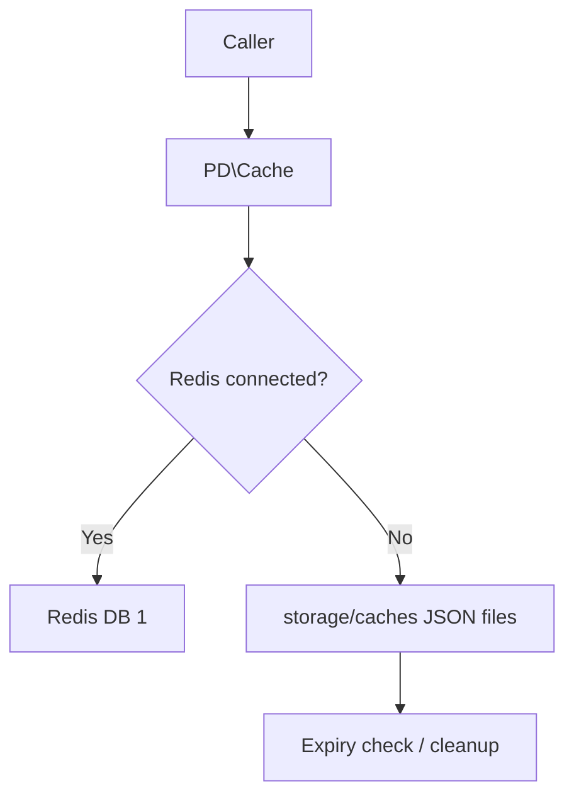

Last updated: 2026-10-25

> [!NOTE]
> This README was generated by [SKILL](https://github.com/agenvoy/skill-readme-generate), get the ZH version from [here](./doc/README.zh.md).

---

<strong>REDIS WHEN IT'S UP, FILES WHEN IT'S DOWN!</strong>

---

> A PHP cache library with Redis-first storage, automatic filesystem fallback, and built-in HTML minification

## Table of Contents

- [Features](#features)
- [Architecture](#architecture)
- [License](#license)
- [Author](#author)

## Features

> `composer require pardnchiu/cache` · [Documentation](./doc/doc.md)

- **Redis First, Files as Fallback** — Reads and writes go to Redis while it is connected and switch to JSON files under the document root when it is not, so caching never stops.
- **Built-in Expiration** — File entries store their expiry time and are deleted on read once stale, while Redis entries rely on EXPIRE.
- **HTML Minification on Write** — Line breaks, indentation, and whitespace between tags are stripped to shrink page caches.
- **MD5 Key Normalization** — Any page identifier hashes into a fixed-length key, avoiding special-character issues in filenames and key names.
- **One-Call Cleanup** — A single method scans the cache directory and removes every expired entry, ready for a cron job.

## Architecture

> [Full Architecture](./doc/architecture.md)

## License

This project is licensed under the [MIT LICENSE](LICENSE).

## Author

Just [open an issue](https://github.com/pardnio/php-cache-fallback/issues/new) to share an idea.

---

©️ 2024 [邱敬幃 Pardn Chiu](https://www.linkedin.com/in/pardnchiu)
