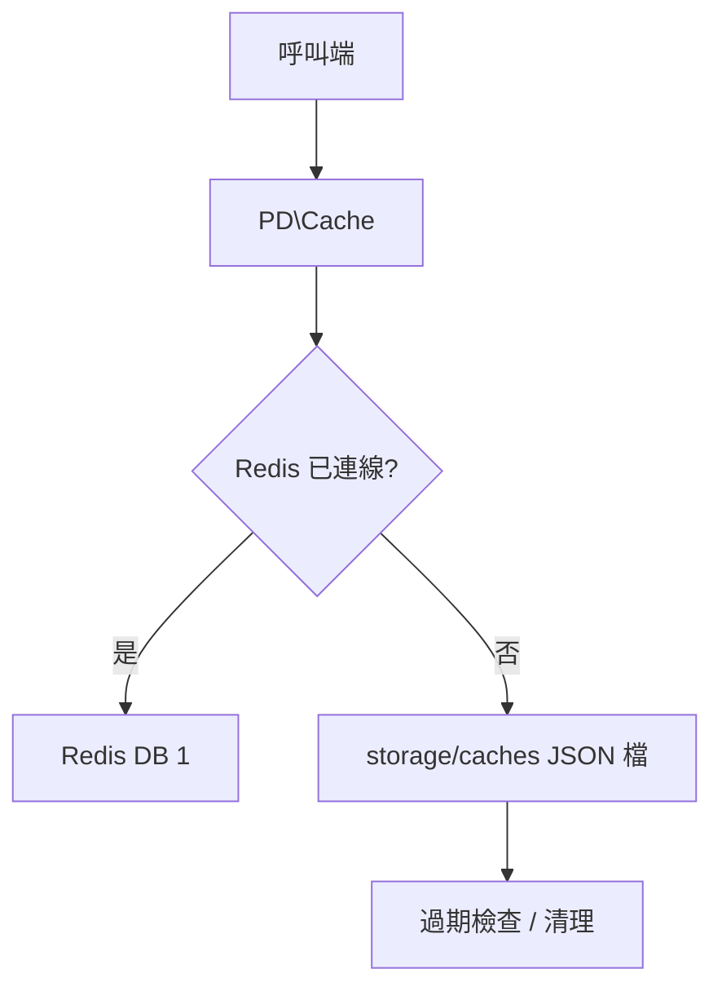

最後更新：2026-10-25

> [!NOTE]
> 此 README 由 [SKILL](https://github.com/agenvoy/skill-readme-generate) 生成，英文版請參閱 [這裡](../README.md)。

---

<strong>REDIS WHEN IT'S UP, FILES WHEN IT'S DOWN!</strong>

---

> PHP 快取函式庫，具備 Redis 優先儲存、自動檔案備援與內建 HTML 壓縮

## 目錄

- [功能特點](#功能特點)
- [架構](#架構)
- [授權](#授權)
- [Author](#author)

## 功能特點

> `composer require pardnchiu/cache` · [完整文件](./doc.zh.md)

- **Redis 優先、檔案備援** — Redis 連線可用時讀寫 Redis，斷線時自動改用網站根目錄下的 JSON 檔案快取，服務不中斷。
- **內建過期機制** — 檔案快取記錄到期時間，讀取時發現過期即刪檔並回傳空值；Redis 端則交由 EXPIRE 處理。
- **寫入前 HTML 壓縮** — 自動移除換行縮排與標籤間空白，縮小頁面快取體積。
- **MD5 鍵值正規化** — 任意頁面識別字串都雜湊成固定長度鍵，避免檔名與鍵名的特殊字元問題。
- **一次清理過期檔** — 單一方法掃描快取目錄並刪除所有過期項目，適合排程執行。

## 架構

> [完整架構](./architecture.zh.md)

## 授權

本專案採用 [MIT LICENSE](../LICENSE)。

## Author

Just [open an issue](https://github.com/pardnio/php-cache-fallback/issues/new) to share an idea.

---

©️ 2024 [邱敬幃 Pardn Chiu](https://www.linkedin.com/in/pardnchiu)
