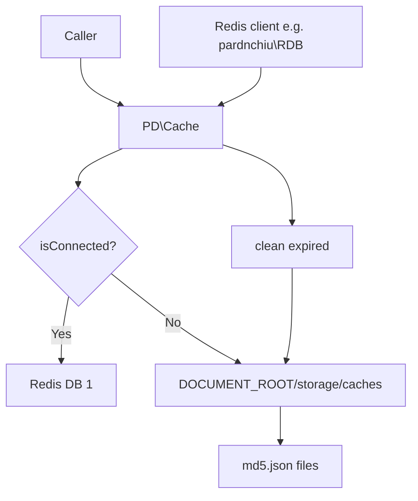
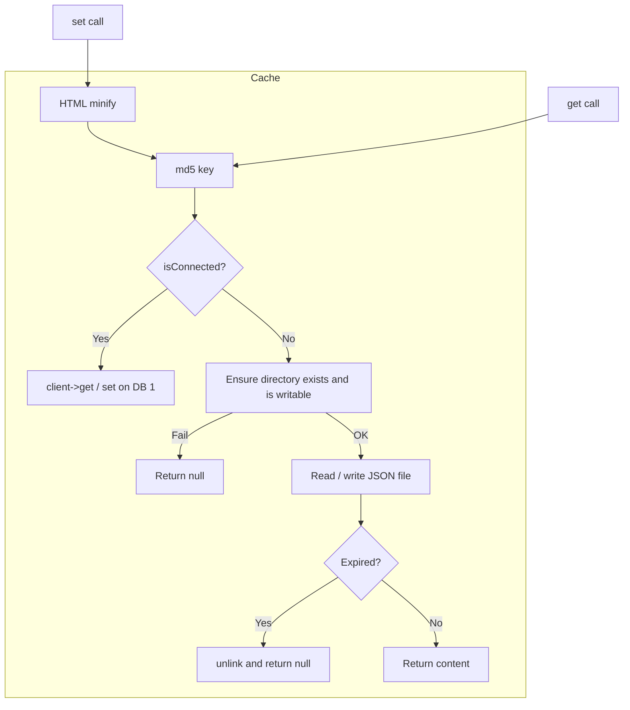
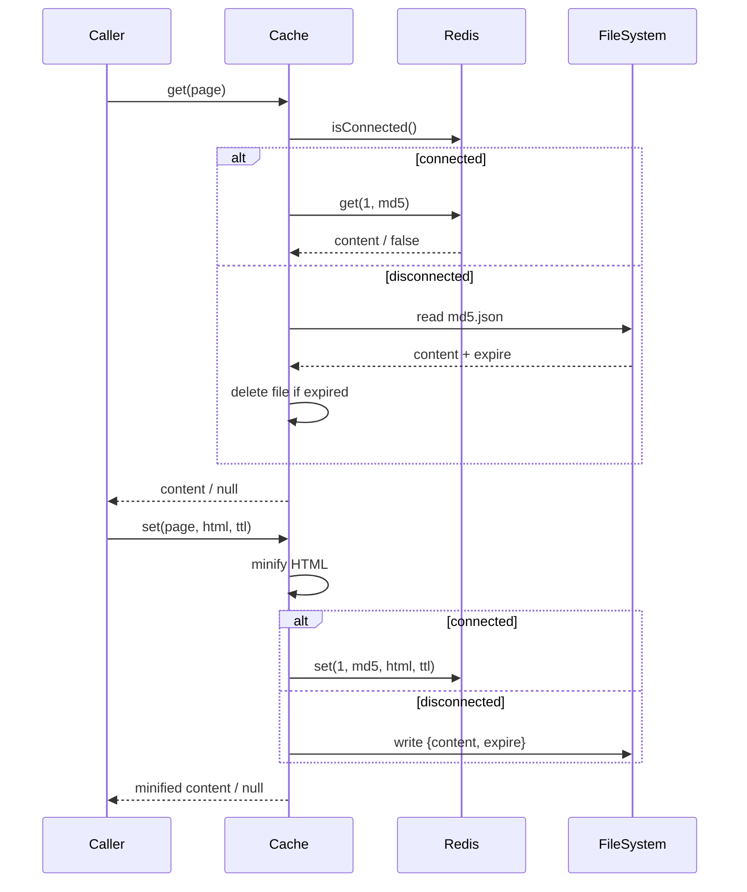

# php-cache-fallback - Architecture

Last updated: 2026-10-25

> Back to [README](../README.md)

## Overview

## Module: Cache

`PD\Cache` asks the injected client whether it is connected on every operation, then takes the Redis or file path.

## Data Flow

***

©️ 2024 [邱敬幃 Pardn Chiu](https://www.linkedin.com/in/pardnchiu)
