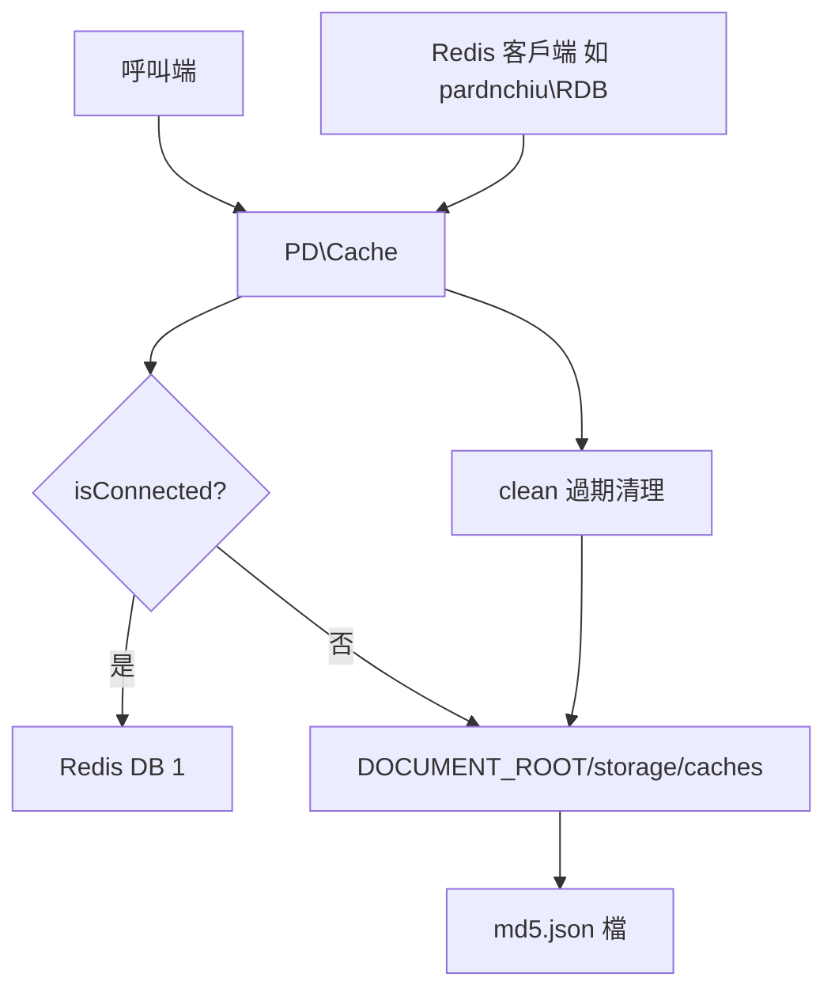
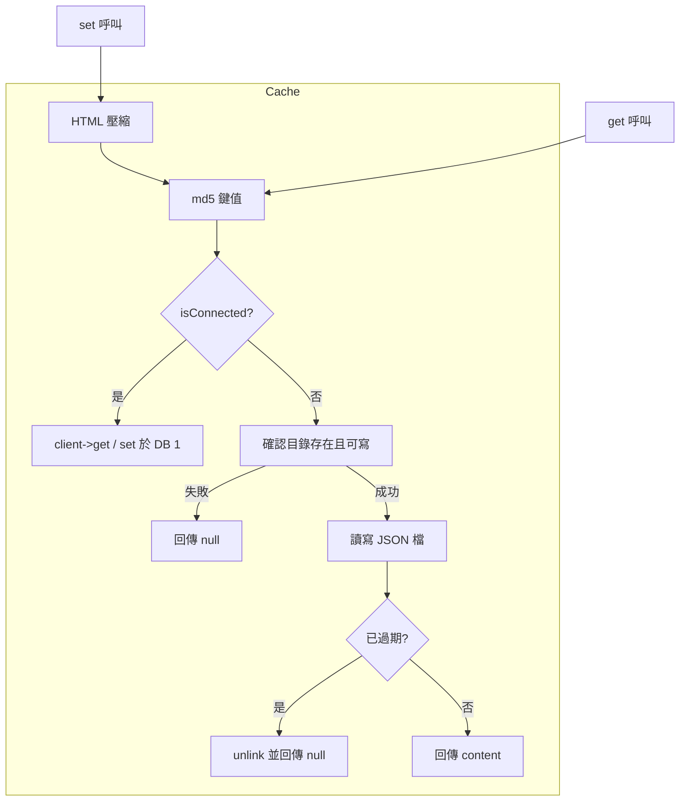
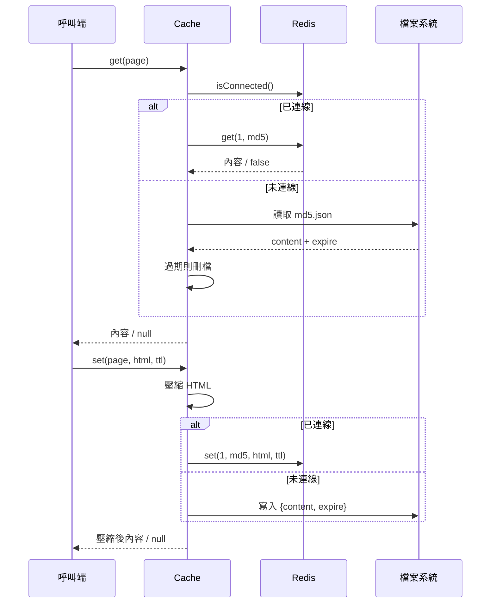

# php-cache-fallback - 架構

最後更新：2026-10-25

> 返回 [README](./README.zh.md)

## 概覽

## Module: Cache

`PD\Cache` 每次操作都先詢問注入的客戶端是否連線，再決定走 Redis 或檔案路徑。

## Data Flow

***

©️ 2024 [邱敬幃 Pardn Chiu](https://www.linkedin.com/in/pardnchiu)
